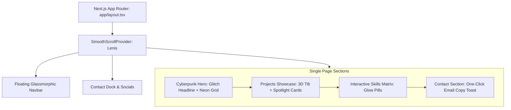

## Goal Capsule

- **Objective:** Deliver a responsive single-page developer portfolio with 3D cursor-tracking card tilt, magnetic spotlight borders, cyberpunk visual elements, and inertia smooth scrolling that loads instantly and maintains 60 FPS transitions.
- **Means:** Next.js (App Router), Tailwind CSS, Framer Motion, and Lenis for inertia smooth scrolling (KTD1, KTD2).
- **Product Authority:** User design choices established during intake (Cyberpunk aesthetic, 3D tilt cards, inertia scroll, cyberpunk hero).
- **Stop Conditions:** All 5 implementation units completed and verified via clean Next.js build and browser responsiveness test.
- **Finished By:** `ce-work` or manual execution in this workspace.

---

## Product Contract

### Summary
A high-performance single-page developer portfolio website styled in a 3D / Spatial Cyberpunk aesthetic. The experience features an interactive hero section with dynamic mesh/grid background and animated glitch/typewriter headline, followed by 3D tilt project cards with cursor-driven radial spotlight borders, interactive tech stack pills, and a contact/dock footer.

### Problem Frame
Traditional portfolio templates feel static, generic, and uninspiring to prospective clients or employers, while overly heavy 3D sites suffer from sluggish performance, layout shift, and poor mobile accessibility. Developers need a distinctive, interactive portfolio that showcases technical craftsmanship and design polish without sacrificing speed or accessibility.

### Requirements

#### Core Architecture & Layout
- R1. Scaffold a Next.js (App Router) project with Tailwind CSS, TypeScript, and ESLint in the portfolio repository.
- R2. Implement buttery-smooth inertial momentum scrolling across the entire page using Lenis.
- R3. Deliver a responsive single-page layout styled with a dark spatial cyberpunk theme (deep zinc/slate-950 base, glowing cyan/neon-purple accents, subtle grid mesh backdrop, and glassmorphism headers).

#### Hero Section
- R4. Create a Cyberpunk-themed Hero section featuring an animated glitch/typewriter headline, cyberpunk badge ("Available for projects"), brief bio, and magnetic action buttons (Resume / Contact / View Projects).
- R5. Render a lightweight CSS/Canvas ambient glowing grid background that reacts subtly to scroll or ambient movement.

#### Projects Showcase & Interactions
- R6. Build a Projects section showcasing featured engineering work with interactive 3D perspective tilt cards.
- R7. Implement cursor-tracking spotlight border glow on hover, revealing project screenshots, tag pills, GitHub repository links, and live demo buttons.
- R8. Ensure graceful mobile fallback: on touch devices where hover/cursor tracking is absent, render cards with clean elevation and active tap glow.

#### Skills & Contact Dock
- R9. Create an interactive Tech Stack & Skills grid with glowing aura badges that illuminate on hover.
- R10. Provide a quick contact dock with social links (GitHub, LinkedIn, X/Twitter, Email) and a one-click copy email feature with visual toast notification.

### Key Decisions
- **Spatial Cyberpunk Visual Direction:** Dark mode default with high-contrast neon glows, glassmorphism backdrop filters, and subtle cyber-grid patterns.
- **3D Tilt & Magnetic Glow Cards:** Cards respond to mouse position via 3D perspective transforms with radial gradient borders following the cursor.
- **Inertial Momentum Scroll:** Global Lenis smooth scroll provider wrapping client components for weighted, smooth browsing.

### Scope Boundaries
- **In-Scope:** Single-page portfolio, Next.js App Router, Tailwind CSS, Lenis, Framer Motion, 3D tilt cards, hero glitch effects, skills section, contact dock, mock/featured project data schema.
- **Deferred to Follow-Up Work:** Backend contact form mailing service (SendGrid/Resend API), full MDX project deep-dive case studies, multi-language internationalization.

---

## Planning Contract

### Key Technical Decisions

- KTD1. **Next.js App Router & Tailwind CSS Architecture**
  - **Choice:** Next.js 14/15 App Router with Tailwind CSS v3/v4 utility classes and Lucide React icons.
  - **Rationale:** Server components render initial shell and metadata with zero client runtime; client components (`'use client'`) isolate interactive animations.

- KTD2. **Animation & Interaction Pipeline**
  - **Choice:** Framer Motion (`motion` components + springs) + `@studio-freight/lenis` (or `lenis/react`).
  - **Rationale:** Hardware-accelerated CSS transforms via Framer Motion handle 3D perspective and mouse tracking at 60 FPS; Lenis provides unified inertia scrolling without hijacking browser navigation.

- KTD3. **3D Tilt & Spotlight Card Logic**
  - **Choice:** Custom React hook calculating normalized coordinates `(x, y)` relative to card bounding box, binding CSS variables `--mouse-x`, `--mouse-y`, `--rotate-x`, and `--rotate-y`.
  - **Rationale:** Keeps mouse-move calculations performant without re-rendering entire component trees on every pointer event.

- KTD4. **Touch & Reduced Motion Accessibility**
  - **Choice:** CSS media queries `@media (prefers-reduced-motion)` and pointer detection `(pointer: fine)`.
  - **Rationale:** Disables intense 3D tilt and smooth scroll overrides on mobile devices or for users requesting reduced motion.

---

## High-Level Technical Design

---

## Implementation Units

### U1. Project Scaffolding & Design System Setup
- **Goal:** Initialize Next.js project with Tailwind CSS, Lucide icons, Framer Motion, and Lenis in the root workspace.
- **Requirements Covered:** R1, R2, R3
- **Files Touched:**
  - `package.json`
  - `tailwind.config.ts` (or `tailwind.config.js`)
  - `app/layout.tsx`
  - `app/globals.css`
  - `components/providers/smooth-scroll-provider.tsx`
- **Approach:**
  - Initialize Next.js with TypeScript and Tailwind CSS.
  - Install dependencies: `framer-motion`, `lenis` (or `@studio-freight/lenis`), `lucide-react`, `clsx`, `tailwind-merge`.
  - Configure Cyberpunk color palette in Tailwind (neon cyan `#00f0ff`, neon purple `#b026ff`, dark zinc `#09090b`, dark border tokens).
  - Create `SmoothScrollProvider` wrapper using Lenis with cleanup on unmount.
- **Test Scenarios:**
  - Project builds cleanly (`npm run build`).
  - Dev server runs (`npm run dev`) and serves root page with Lenis smooth scroll active.

### U2. Cyberpunk Ambient Background & Floating Navigation
- **Goal:** Implement persistent cyber-grid mesh background, ambient glowing gradient orbs, and glassmorphism floating navbar.
- **Requirements Covered:** R3, R4, R5
- **Files Touched:**
  - `components/ui/cyber-grid-background.tsx`
  - `components/navigation/navbar.tsx`
  - `app/page.tsx`
- **Approach:**
  - Build fixed ambient background with CSS radial gradients and futuristic SVG grid lines.
  - Build floating top navbar with backdrop blur (`backdrop-blur-md bg-black/40 border border-cyan-500/20`), brand logo with glow, and jump-links to `#hero`, `#projects`, `#skills`, `#contact`.
- **Test Scenarios:**
  - Navbar remains fixed with smooth backdrop blur over content.
  - Jump links smoothly navigate to target anchors without breaking Lenis momentum.

### U3. Cyberpunk Hero Section with Glitch/Typewriter Headline
- **Goal:** Create high-impact hero header with animated headline, neon status badge, and magnetic CTA buttons.
- **Requirements Covered:** R4, R5
- **Files Touched:**
  - `components/sections/hero.tsx`
  - `components/ui/glitch-text.tsx`
  - `components/ui/magnetic-button.tsx`
- **Approach:**
  - Build `GlitchText` component using Framer Motion keyframe offsets or CSS pseudo-element glitch animations.
  - Add "Available for work" glowing badge with pulsating green/cyan dot.
  - Implement `MagneticButton` using spring physics (`type: "spring", stiffness: 250, damping: 15`).
- **Test Scenarios:**
  - Glitch headline plays on load without layout shift.
  - Hovering CTA buttons produces magnetic pull toward cursor.

### U4. 3D Tilt Project Cards with Spotlight Border Glow
- **Goal:** Build the projects showcase grid featuring 3D perspective tilt cards and cursor-following spotlight glow.
- **Requirements Covered:** R6, R7, R8
- **Files Touched:**
  - `data/projects.ts`
  - `components/sections/projects.tsx`
  - `components/ui/project-card.tsx`
  - `hooks/use-mouse-tilt.ts`
- **Approach:**
  - Create typed project dataset with titles, descriptions, tech stacks, live links, and image placeholders.
  - Implement `useMouseTilt` calculating relative rotation (`rotateX`, `rotateY`) and radial spotlight coordinates (`clientX - rect.left`).
  - Render card with 3D perspective wrapper (`perspective: 1000px`), glowing border mask, live demo button, and GitHub button.
  - Add mobile touch detection to disable tilt transform and preserve static card clarity.
- **Test Scenarios:**
  - Moving cursor across project card tilts card in 3D perspective and moves radial spotlight.
  - Mouse leave smoothly transitions card back to center `(0, 0)`.
  - External links open in new tabs with `rel="noopener noreferrer"`.

### U5. Interactive Skills Matrix, Contact Dock, & Polish
- **Goal:** Build interactive skill badge matrix and contact footer dock with one-click email copy toast.
- **Requirements Covered:** R9, R10
- **Files Touched:**
  - `data/skills.ts`
  - `components/sections/skills.tsx`
  - `components/sections/contact.tsx`
  - `components/ui/toast.tsx`
- **Approach:**
  - Categorize skills (Frontend, Backend, DevOps, Tools) rendered as neon badge pills with hover glow.
  - Build Contact section with direct social buttons (GitHub, LinkedIn, Twitter/X) and "Copy Email" action.
  - When email is copied, display a toast notification ("Copied to clipboard!") with auto-dismiss.
- **Test Scenarios:**
  - Clicking "Copy Email" writes address to clipboard and shows toast.
  - Hovering skill pills triggers neon glow scale transition.
  - Page is responsive across mobile, tablet, and desktop breakpoints.

---

## Verification Contract

- **Build Check:** `npm run build` must complete with 0 errors.
- **Lint Check:** `npm run lint` must pass cleanly.
- **Visual & Interaction Verification:**
  - Lenis smooth momentum scrolling active on scroll.
  - Project cards tilt in 3D and show cursor spotlight on desktop.
  - Glitch headline and magnetic buttons function smoothly at 60 FPS.
  - Email copy toast fires and copies string to clipboard.
  - Responsive layout verified on mobile (375px), tablet (768px), and desktop (1280px+).

---

## Definition of Done

- All 5 Implementation Units (U1–U5) completed and integrated into `app/page.tsx`.
- Next.js production build (`npm run build`) succeeds with 0 errors.
- Codebase contains clean documentation and modular component structure.
- All unused experimental/stub code removed before completion.

## Icons and other things

- Use the icons related to themes 
