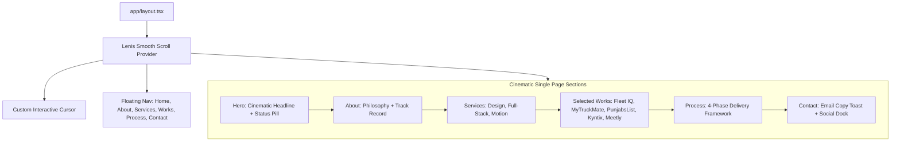

## Goal Capsule

- **Objective:** Upgrade our developer portfolio into a high-end, cinematic, editorial agency-grade experience inspired by `https://jashanparial.web.app/` — featuring luxury dark typography (Satoshi/Inter), custom smooth cursor tracking, dynamic project showcase cards with rich industry tags and live links, interactive services breakdown, engineering process walkthrough, stack badges, and a contact drawer.
- **Means:** Next.js (App Router), Tailwind CSS, Framer Motion springs, Lenis smooth scrolling, GSAP-style cursor tracking, and custom SVG ornaments (KTD1, KTD2).
- **Product Authority:** User request referencing `https://jashanparial.web.app/`.
- **Stop Conditions:** All 5 implementation units completed, verified via clean Next.js build, and all sections responsive and interactive.
- **Finished By:** `ce-work` or interactive implementation in this workspace.

---

## Product Contract

### Summary
Transform our single-page portfolio to match the design language of `https://jashanparial.web.app/`. The site balances sleek editorial typography, a luxury dark backdrop (`#0A0A0A` / `#050505`), custom cursor physics, and comprehensive sections:
1. **Hero:** Cinematic headline ("Crafting Digital Experiences"), status badge ("Available for projects"), personal bio statement, and animated scroll indicator.
2. **About & Philosophy:** Founder/engineer narrative ("I partner with founders to design and build products that feel inevitable"), career stats, and core engineering tenets.
3. **Services:** Core offerings (Product Design, Web Development, Motion & Interaction) with detailed tool chips and delivery scopes.
4. **Selected Works:** Real-world case studies (Fleet IQ, MyTruckMate, PunjabsList, Kyntix Tech, Meetly) featuring rich gradient ornaments, industry tags, role breakdown, and live launch links.
5. **Stack & Process:** 4-step execution framework ("Listen & Align", "Architect", "Build & Polish", "Ship & Scale") with curated technologies and developer tools.
6. **Contact & Social Dock:** Direct booking CTA, copy-email feedback toast, and social channels.

### Problem Frame
The current spatial cyberpunk portfolio provides strong 3D tilt effects, but the user requested adopting the refined, cinematic, real-world portfolio architecture of `https://jashanparial.web.app/`. That design emphasizes agency-grade credibility, editorial typography, structured case studies with real client metrics, and a full-suite freelance services breakdown.

### Requirements

#### Core Aesthetic & Typography
- R1. Integrate luxury editorial typography matching Satoshi / Inter font aesthetics with deep pitch-black (`#0A0A0A`) surfaces, subtle borders (`border-white/10`), and warm violet/gold accent glows.
- R2. Implement an optional custom trailing cursor with spring physics on desktop devices (auto-disabled on touch).
- R3. Preserve buttery-smooth inertia scrolling powered by Lenis across all sections.

#### Navigation & Hero Section
- R4. Deploy an editorial floating navigation bar with direct jump links: Home, About, Services, Works, Process, Contact.
- R5. Build a cinematic Hero section with badge status ("Available for Q1/Q2 engagements"), high-impact typography ("CRAFTING CINEMATIC DIGITAL EXPERIENCES"), and interactive action pills.

#### About & Services
- R6. Create an About section detailing experience, philosophy, and key stats (6+ years, 40+ engagements, 100% on-time delivery).
- R7. Create a Services section highlighting 3 distinct offerings (Product Design, Full-Stack Engineering, Motion & Interaction) with tool lists and deliverables.

#### Selected Works Showcase
- R8. Implement the full portfolio project roster inspired by Jashan Parial's site:
  - **Fleet IQ:** Real-time logistics command center (Next.js, Tailwind, Mapbox GL, PostgreSQL)
  - **MyTruckMate:** Driver-first mobility marketplace & PWA (React, Vite, Express, Stripe)
  - **PunjabsList:** Pan-regional multi-tenant classifieds platform (Next.js, Node.js, Redis)
  - **Kyntix Tech:** High-performance IT consulting portfolio (Next.js, Framer Motion)
  - **Meetly:** Virtual event streaming platform (WebRTC, Socket.io, Node.js)
- R9. Each project card must display index number (`01`, `02`), industry, role, live demo URL, gradient backdrop ornament, and stack tags.

#### Process & Contact
- R10. Build an engineering process section illustrating the 4-phase execution workflow: Discover, Design, Build, Ship.
- R11. Provide a direct contact section with one-click email copy toast, consultation booking button, and social links.

---

## Planning Contract

### Key Technical Decisions

- KTD1. **Editorial Design Tokens & Font Stack**
  - **Choice:** Modern sans font pairing with high-contrast neutral scales (`zinc-950`, `zinc-900`, `zinc-800`), glowing accent colors (`#8B5CF6` violet, `#EAB308` amber, `#10B981` emerald), and subtle glassmorphic borders.
  - **Rationale:** Captures the exact luxury agency feel of `jashanparial.web.app` without unnecessary visual clutter.

- KTD2. **Data-Driven Architecture**
  - **Choice:** Modular data structures in `data/projects.ts`, `data/services.ts`, and `data/process.ts`.
  - **Rationale:** Easy for the user to customize their real projects, links, and text without editing React components.

- KTD3. **Smooth Interactive Cursor**
  - **Choice:** Client-side custom mouse tracker (`components/ui/custom-cursor.tsx`) active only on `pointer: fine` devices.
  - **Rationale:** Provides the signature cinematic agency cursor hover feel without degrading performance or touch screens.

---

## High-Level Technical Design

---

## Implementation Units

### U1. Design System & Typography Upgrade
- **Goal:** Update global styles, font tokens, and theme colors to match the cinematic `#0A0A0A` palette of `jashanparial.web.app`.
- **Files Touched:**
  - `app/globals.css`
  - `app/layout.tsx`
  - `components/ui/custom-cursor.tsx`
- **Approach:**
  - Update `globals.css` with dark luxury background `#0a0a0a`, smooth scrollbar, and card border tokens.
  - Add optional `CustomCursor` component with spring lerping for desktop.

### U2. Data Schemas (Projects, Services, Process)
- **Goal:** Establish typed datasets matching the exact projects, services, and process of the reference site.
- **Files Touched:**
  - `data/projects.ts`
  - `data/services.ts`
  - `data/process.ts`
- **Approach:**
  - Populate Fleet IQ, MyTruckMate, PunjabsList, Kyntix Tech, Meetly with accurate tags, roles, and links.
  - Add Services data (Product Design, Web Development, Motion & Interaction).
  - Add Process steps (Discover, Architect, Build, Ship).

### U3. Hero & About Sections
- **Goal:** Build the cinematic hero and biographical about section with career milestones and statistics.
- **Files Touched:**
  - `components/sections/hero.tsx`
  - `components/sections/about.tsx`
- **Approach:**
  - Create headline: "Crafting Cinematic Digital Experiences for Startups & Ambitious Brands".
  - Build About grid with founder bio, core principles, and 4 statistical callouts.

### U4. Services & Process Framework Sections
- **Goal:** Implement the Services matrix and 4-step Delivery Process.
- **Files Touched:**
  - `components/sections/services.tsx`
  - `components/sections/process.tsx`
- **Approach:**
  - Render services cards with tool chips (Figma, React, Next.js, Framer Motion, GSAP, WebGL).
  - Build numbered process roadmap (`01 Discovery` → `02 Architecture` → `03 Engineering` → `04 Production`).

### U5. Selected Works Showcase & Contact Section
- **Goal:** Build the comprehensive Projects case study showcase with live links and the interactive Contact footer.
- **Files Touched:**
  - `components/sections/projects.tsx`
  - `components/ui/project-card.tsx`
  - `components/sections/contact.tsx`
  - `components/navigation/navbar.tsx`
  - `app/page.tsx`
- **Approach:**
  - Enhance `ProjectCard` with role badges, year, industry, gradient backdrop, and source/live links.
  - Update Navbar with all 6 section links.
  - Assemble full page in `app/page.tsx`.

---

## Verification Contract

- **Build Check:** `npm run build` must compile with 0 errors and full static optimization.
- **Visual Checks:**
  - Dark luxury `#0A0A0A` theme across entire scroll depth.
  - All 6 sections (Hero, About, Services, Projects, Process, Contact) navigable via top navbar.
  - Project cards render case studies with working external links (`fleetiqs.com`, `mytruckmate.com.au`, etc.).
  - Smooth Lenis scrolling remains active and fluid.

---

## Definition of Done

- All 5 units (U1–U5) completed and verified in code.
- Next.js production build (`npm run build`) passes cleanly.
- Portfolio matches the aesthetic and section architecture of `https://jashanparial.web.app/`.
