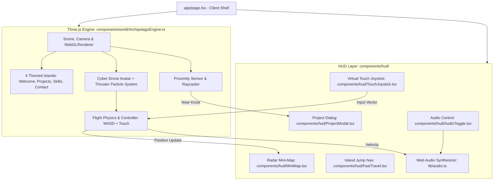

## Goal Capsule

- **Objective:** Redesign the developer portfolio into an interactive, gamified 3D experience where visitors pilot a floating cyber drone/hovercraft across a vibrant low-poly archipelago to explore projects, skills, and contact channels with zero friction.
- **Means:** Next.js (App Router), Three.js (hardware-accelerated WebGL), custom flight physics engine, Web Audio API procedural sound synthesizer, and responsive virtual touch joystick.
- **Product Authority:** User decisions settled during intake (Stylized Low-Poly Archipelago art style, direct exploration with in-game kiosks & mini-map, floating cyber drone avatar, 4 dedicated islands, dynamic synth audio & touch joystick).
- **Open Blockers:** None. Ready for execution.

---

## Product Contract

*(Product Contract preservation: unchanged)*

### Summary
An interactive gamified 3D portfolio website set on a stylized low-poly floating archipelago. Visitors pilot a responsive floating cyber drone / hovercraft across four themed islands (Welcome Island, Project Archipelago, Skill Grove, and Contact Beacon), uncovering project kiosks, collecting skill crystals, and triggering high-impact visual and sound effects, supported by an on-screen mini-map and mobile touch joystick.

### Problem Frame
Standard developer portfolio websites follow predictable vertical card layouts that fail to leave a lasting impression on prospective clients, technical recruiters, and collaborators. At the same time, overly complex WebGL experiments often disorient users with sluggish framerates, clunky controls, or obscured project information. The portfolio needs to combine genuine playful interactivity and visual delight with instantaneous readability of core engineering work and contact details.

### Key Decisions
- **Stylized Low-Poly Floating Archipelago Aesthetic:** (session-settled: user-directed — chosen over cyberpunk metropolis, synthwave grid, and modernist pavilion) Clean pastel/vibrant colors, floating sky islands with bridges, cozy sunlight, volumetric clouds, and floating crystals for high visual impact and lightweight rendering performance. Governs R1, R2.
- **Direct 3D Game World with In-Game Kiosks & Mini-Map:** (session-settled: user-directed — chosen over hybrid 2D drawer mode) Full-screen 3D world as the primary viewport; approaching project pedestals/kiosks smoothly focuses the camera and displays interactive glassmorphism dialogs with live demos, code repos, and tech tags. Governs R3, R4, R5.
- **Floating Cyber Drone / Hovercraft Avatar:** (session-settled: user-directed — chosen over ground rover and humanoid character) Smooth gliding physics with camera banking, vertical hovering, thruster particle trails, and boost capabilities, preventing terrain collision snagging while feeling fluid to navigate. Governs R6, R7.
- **Four Dedicated Themed Islands:** (session-settled: user-directed — chosen over single mega-island and warp portals) Modular island structure distributing content into Welcome Island, Project Archipelago, Skill Grove, and Contact Beacon. Governs R8, R9, R10, R11.
- **Dynamic Audio & On-Screen Touch Joystick:** (session-settled: user-directed — chosen over sound fx only and silent mode) Ambient synth soundscape with thruster hum and interaction chimes (muted by default with persistent audio toggle button) alongside responsive on-screen virtual stick on mobile devices. Governs R12, R13.

### Requirements

#### 3D World & Environment
- R1. Render an interactive 3D sky archipelago featuring stylized low-poly floating landmasses, bridges/sky-paths, water/cloud layers, and soft directional sun lighting.
- R2. Maintain stable 60 FPS performance across desktop and mobile devices through efficient geometry instancing and optimized low-poly shaders.

#### Exploration & Avatar Mechanics
- R3. Provide an intuitive camera and vehicle controller that allows the cyber drone to glide, rotate, elevate, and boost across the islands using desktop keyboard controls (WASD / Arrow Keys + Space for boost).
- R4. Display glowing thruster particle trails and dynamic camera banking tilts that react smoothly to directional movement and velocity.
- R5. Provide an on-screen mini-map HUD showing the player's real-time position, heading, and icons for each island and unvisited project kiosks.

#### Content Islands & Project Kiosks
- R6. Welcome Island: Provide a dedicated spawn landing pad featuring the developer bio, title badge, core specialization, and an introductory flight control prompt.
- R7. Project Archipelago: Feature 3D display pedestals / holographic monoliths for each project (e.g., House Price AI, MyTruckMate, etc.) that light up upon drone proximity.
- R8. In-Game Project Dialogs: Triggering an active project kiosk smoothly halts the drone and opens a responsive modal overlay with project summary, architecture highlights, live demo link, and GitHub repository button.
- R9. Skill Grove: Present an interactive forest of floating tech stack crystals/power-ups (Next.js, TypeScript, Python, Tailwind, etc.) that spin, emit sound chimes, and highlight proficiency when collected or approached.
- R10. Contact Beacon: Feature a futuristic transmission tower / satellite station equipped with an interactive contact form, copy-email action with visual confirmation, and social links (GitHub, LinkedIn, X).

#### Audio, Controls & Mobile Support
- R11. Implement ambient futuristic synth music and audio feedback (engine hum, crystal collection chimes, kiosk activation tones) with an immediate mute/unmute toggle control.
- R12. Provide a responsive on-screen touch joystick and action button overlay when accessed on touch-enabled or mobile viewports.
- R13. Provide a quick teleport/fast-travel menu accessible from the HUD so visitors can jump directly to any island or kiosk instantly if desired.

### Key Flows

#### F1: First-Time Visitor Journey
- **Trigger:** Visitor navigates to portfolio homepage.
- **Covers R1, R6, R11.**
- 1. Sky and archipelago fade in with gentle camera zoom to the cyber drone parked on the Welcome Island landing pad.
- 2. A brief, non-intrusive control hint appears ("Use WASD or drag to fly").
- 3. Subtle ambient synth music is ready to play upon user interaction or toggle.
- 4. Visitor takes off and explores towards the Project Archipelago or Skill Grove.

#### F2: Inspecting a Project Kiosk
- **Trigger:** Drone approaches within interaction radius of a project pedestal on Project Archipelago.
- **Covers R7, R8.**
- 1. The kiosk pedestal illuminates with an emissive aura and an interactive prompt appears ("Press E or Tap to Inspect").
- 2. Triggering inspection smoothly glides the camera into an optimal framing angle and opens an in-game glassmorphism modal with project screenshots, tech stack, and external links.
- 3. Closing the modal returns camera control smoothly to the drone without jarring jumps.

#### F3: Fast-Travel via Mini-Map / HUD
- **Trigger:** Visitor clicks or taps an island marker on the mini-map or fast-travel bar.
- **Covers R5, R13.**
- 1. Drone initiates a smooth hyperspace/glide transition directly toward the selected island's landing beacon.
- 2. Player gains instant access to that section's content.

### Acceptance Examples

#### AE1: Mobile Viewport Experience
- **Covers R12.**
- **Given** a visitor opens the site on a smartphone (e.g., iOS Safari or Android Chrome),
- **When** the 3D scene finishes loading,
- **Then** a transparent floating virtual joystick appears on the bottom-left of the screen and a boost/interact button on the bottom-right, allowing one-thumb steering and full access to all four islands.

#### AE2: Audio Autoplay & Persistence
- **Covers R11.**
- **Given** browser autoplay policies restrict unmuted audio on load,
- **When** the page initializes,
- **Then** audio starts muted with a visible speaker icon in the top header; toggling sound un-mutes both ambient music and sound FX, saving the user preference in local storage.

### Scope Boundaries
- **In Scope (v1):**
  - Complete 3D floating archipelago environment with 4 themed islands.
  - Floating cyber drone flight controller with particle effects and smooth camera.
  - Interactive project pedestals showing real portfolio data and links.
  - Skill Grove with collectible floating crystals.
  - Contact Beacon with working message sending and copy-email.
  - On-screen mini-map and fast-travel shortcuts.
  - Ambient audio engine with sound effects and mute toggle.
  - Full mobile responsiveness with virtual joystick.
- **Deferred for Later:**
  - Multiplayer ghost drones (seeing other concurrent visitors fly around).
  - Custom drone skin/paint customizer.
  - Time-of-day / weather slider (day, sunset, rain, night modes).

---

## Planning Contract

### Key Technical Decisions

- KTD1. **Direct Three.js Canvas Controller with Next.js Client Boundary**
  - **Choice:** Install `three` and `@types/three` with a dedicated TypeScript canvas engine module encapsulated inside a Next.js client component (`'use client'`).
  - **Rationale:** Avoids React 19 reconciler version conflicts with legacy fiber wrappers, guarantees predictable 60 FPS requestAnimationFrame loops without React state re-render overhead during high-speed drone flight, and gives direct control over geometry, lighting, particle buffers, and camera interpolation. Governs U1, U2.
- KTD2. **Lightweight Low-Poly Procedural Geometry & Flat Shading**
  - **Choice:** Generate islands, rocks, trees, water planes, and monoliths programmatically using Three.js primitive geometries with MeshStandardMaterial / MeshToonMaterial (flat shading enabled).
  - **Rationale:** Zero megabyte 3D file download penalties (no 50MB glTF model downloads that slow down initial page loads). The site loads in under 1 second, runs buttery smooth on budget mobile phones, and adheres strictly to the stylized Nintendo/Monument Valley aesthetic. Governs U1, U3, U4.
- KTD3. **Smooth Inertia Damped Flight Dynamics with Quaternions**
  - **Choice:** Velocity, angular velocity, and tilt banking calculated per delta time with smooth damping (`lerp` and quaternion slerp).
  - **Rationale:** Delivers a premium, satisfying gliding feel without wheel-stuck physics bugs. Collision avoidance is handled via simple island radius bounding cylinders rather than expensive mesh colliders. Governs U2.
- KTD4. **Pure Web Audio API Procedural Sound Engine**
  - **Choice:** Synthesize soft ambient drone chords, thruster white noise, and crystal chimes using browser native `AudioContext` oscillators, gain nodes, and biquad filters.
  - **Rationale:** Eliminates external MP3/WAV audio assets and asset-loading failures, provides zero network latency audio response, and enables dynamic pitch shifting tied directly to the drone's flight speed. Governs U5.
- KTD5. **Reactive HUD Overlay with DOM-Layer Modals & Canvas Mini-Map**
  - **Choice:** Project modals, fast-travel drawer, controls hint, and audio toggles rendered in high-performance HTML/Tailwind over the WebGL canvas; mini-map rendered on a lightweight 2D canvas overlay.
  - **Rationale:** Preserves native text accessibility, copy-paste functionality, search-engine indexing, and screen-reader compatibility for project descriptions and contact forms. Governs U3, U5.

---

## High-Level Technical Architecture

---

## Implementation Units

### U1. Three.js Dependency & 3D Archipelago Engine Scaffolding
- **Goal:** Install Three.js, build the full-screen canvas container, lighting setup (ambient + soft directional sun), stylized sky gradient, floating low-poly islands with bridges, and cloud particles.
- **Requirements Covered:** R1, R2.
- **Files Touched:**
  - `package.json`
  - `components/world/ThreeCanvas.tsx`
  - `components/world/ArchipelagoEngine.ts`
  - `components/world/IslandGenerator.ts`
  - `app/page.tsx`
- **Verification:** Run `npm run build` cleanly; inspect canvas initializing with 60 FPS floating low-poly islands and soft rotating clouds.

### U2. Floating Cyber Drone Flight Physics & Thruster Particle Trail
- **Goal:** Implement the playable hovercraft/drone mesh with smooth hover bobbing, WASD/Arrow key flight controls, smooth banking into turns, spacebar boost, and an emissive thruster particle trail.
- **Requirements Covered:** R3, R4.
- **Files Touched:**
  - `components/world/DroneController.ts`
  - `components/world/ThrusterParticles.ts`
  - `components/world/ArchipelagoEngine.ts`
- **Verification:** User can fly drone across 3D space, bank smoothly left and right, boost with spacebar, and observe trailing neon thruster particles.

### U3. Content Island Stations & Interactive Project Kiosks
- **Goal:** Place the Welcome Island landing pad, interactive project monolith pedestals on Project Archipelago, and bind existing portfolio projects (`data/projects.ts`) to proximity triggers that open glassmorphism project modals.
- **Requirements Covered:** R6, R7, R8.
- **Files Touched:**
  - `components/world/KioskManager.ts`
  - `components/hud/ProjectModal.tsx`
  - `data/projects.ts`
  - `components/world/ArchipelagoEngine.ts`
- **Verification:** Flying near any project kiosk illuminates its beacon and displays an interact prompt ("Press E / Tap"); inspecting displays the project modal with live demo and GitHub links.

### U4. Skill Grove Crystals & Contact Beacon Station
- **Goal:** Build the Skill Grove containing spinning collectible crystals (Next.js, Python, TypeScript, etc.) with proximity illumination, and the Contact Beacon transmission tower with an interactive message form and email copy action.
- **Requirements Covered:** R9, R10.
- **Files Touched:**
  - `components/world/SkillCrystals.ts`
  - `components/hud/ContactBeaconModal.tsx`
  - `data/skills.ts`
  - `components/world/ArchipelagoEngine.ts`
- **Verification:** Flying through skill crystals triggers spin and glow animation; approaching Contact Beacon allows sending contact messages or copying email address with toast feedback.

### U5. Mini-Map Radar, Web Audio Synth & Mobile Touch Joystick
- **Goal:** Implement the on-screen radar mini-map tracking drone position, top-bar fast-travel buttons, native Web Audio ambient synth sound engine with mute button, and responsive mobile virtual touch joystick.
- **Requirements Covered:** R5, R11, R12, R13.
- **Files Touched:**
  - `components/hud/MiniMap.tsx`
  - `components/hud/TouchJoystick.tsx`
  - `components/hud/FastTravel.tsx`
  - `components/hud/AudioToggle.tsx`
  - `lib/audio.ts`
  - `app/page.tsx`
- **Verification:** Mini-map reflects drone coordinates in real-time; sound toggle starts muted and plays ambient chord & flight swoosh on activation; on mobile viewports, touch joystick allows intuitive one-thumb flight.

---

## Verification Contract

### Automated Checks
- `npm run lint` — Confirm TypeScript and ESLint pass without errors.
- `npm run build` — Verify production Next.js build passes with zero WebGL or SSR window-undefined issues.

### Manual Acceptance Matrix
| Test Case | Steps | Expected Result |
|---|---|---|
| Desktop Flight | Launch page, press W/A/S/D | Drone lifts off smoothly, banks into turns, emits thruster trail |
| Project Inspection | Fly to Project Archipelago, press E near monolith | Camera glides to kiosk, project modal opens with links |
| Fast Travel | Click "Skill Grove" on HUD fast-travel bar | Drone smoothly glides to Skill Grove coordinates instantly |
| Sound Synthesizer | Click speaker icon in HUD | Ambient synth chords fade in; drone boost shifts pitch higher |
| Mobile Touch | Open in mobile emulation / touch screen | Virtual joystick appears; dragging stick steers and moves drone |
